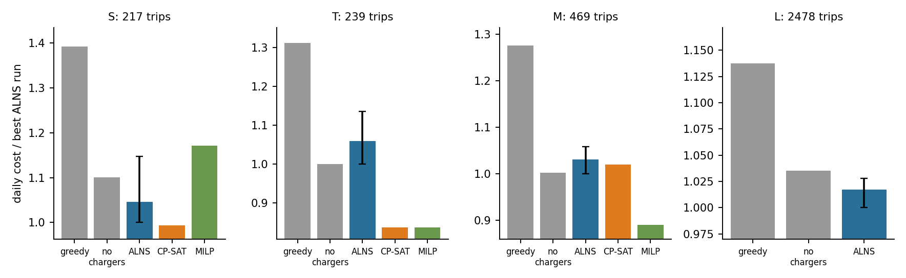
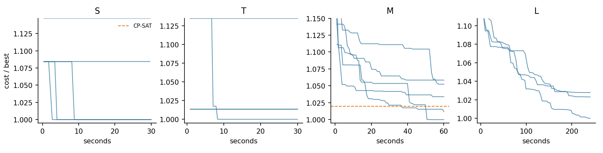
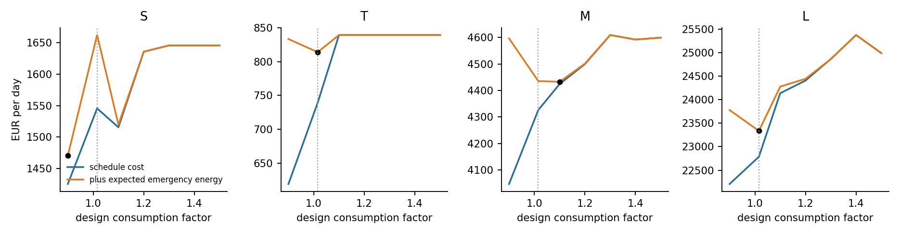
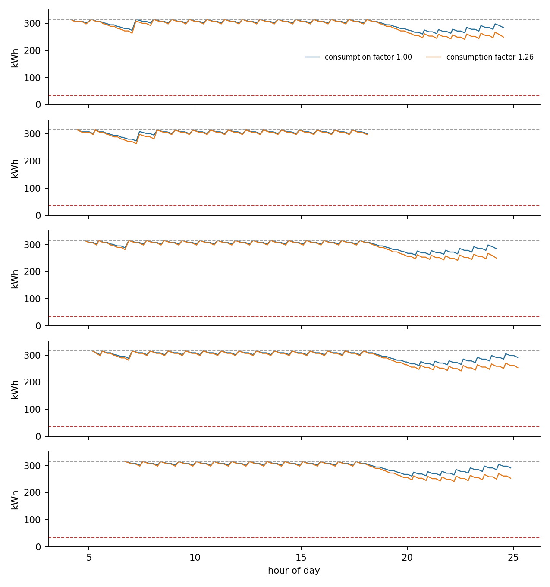
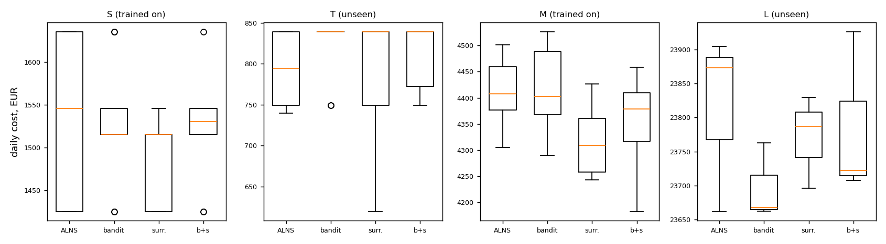

# Electric bus scheduling with opportunity charging (Hamburg GTFS)

Vehicle scheduling for an electric bus fleet on the public HVV timetable of one weekday (Tuesday 10 December 2024). Every timetabled trip is assigned to a bus block, buses are limited by battery range, and the model decides where to place charging terminals and when a bus returns to the depot. Three solvers work on the same problem and the same cost function: a custom adaptive large neighbourhood search (ALNS), OR-Tools CP-SAT and a HiGHS mixed-integer program. A two-stage stochastic version treats winter consumption as uncertain. A FastAPI service with a Dockerfile wraps the solvers.

Research and portfolio project on public data. **Costs, battery, consumption law and depot location are assumptions; no operator data is used and the feed does not identify any operator's real schedule or fleet.** Nothing here is a plan for any transport company.



## Problem

- **Trips:** 217 to 2,478 timetabled trips from the HVV GTFS feed (December 2024), terminals identified by stop name, trip length from shape geometry.
- **Bus:** 350 kWh battery, usable window 10 to 90%, consumption 1.6 kWh/km (assumed, includes heating at about 5 °C, the Hamburg winter median).
- **Connections:** a bus waits at a terminal (and charges there if the terminal has a 300 kW pantograph), drives empty to another terminal, or goes to the depot (120 kW average charger) when the gap is long enough.
- **Cost per day (assumed):** 120 EUR per bus, 40 EUR per charging terminal, 90 EUR per charge point (the maximum number of buses charging at once), 1.1 EUR per deadhead km, 0.22 EUR/kWh electricity.
- **Decisions:** blocks, which terminals get chargers, and for each block where it charges.

Four instances are built by `scripts/build_instances.py`:

| Instance | Trips | Terminals | Service km | Lower bound on fleet (unlimited range) |
|---|---|---|---|---|
| S | 217 | 3 | 2,238 | 10 |
| T | 239 | 2 | 1,010 | 5 |
| M | 469 | 7 | 6,007 | 27 |
| L | 2,478 | 31 | 26,668 | 123 |

## Methods

- **ALNS** (`src/ebus/alns.py`): five destroy operators (random, related, whole blocks, longest waits, open or close a charging site), greedy repair, simulated-annealing acceptance, adaptive operator weights. Every block is planned by an exact backward dynamic program over the charging decisions, and every candidate is costed exactly.
- **CP-SAT** (`src/ebus/cpsat.py`): circuit model over trips with a depot node, battery as integer state, charge-point count by a cumulative constraint with variable capacity.
- **MILP** (`src/ebus/exact.py`): arc-flow formulation for scipy/HiGHS. Its objective agrees with the independent cost re-evaluation (checked in the tests).
- **Validation** (`src/ebus/validate.py`): independent check that every trip is served once, connections are possible in time and the battery stays in its window. All solutions reported here pass it.
- **Uncertainty** (`src/ebus/stoch.py`): consumption factor scenarios from Hamburg winter temperatures (Open-Meteo, five scenarios), emergency energy priced at 2.5 EUR/kWh, recourse problem RP, expected value problem EEV, wait-and-see WS, VSS and EVPI.

## Results

Daily cost in EUR (assumed unit costs), ALNS 5 runs of 30 to 60 s (L: 3 runs of 240 s), CP-SAT 120 to 300 s, HiGHS 200 to 300 s:

| Instance | ALNS best (range) | CP-SAT | HiGHS MILP | No chargers (ALNS) | Greedy, chargers everywhere |
|---|---|---|---|---|---|
| S | 1,426 (1,426-1,636) | **1,415.5**, optimal | 1,669.9, gap 22% | 1,569 | 1,986 |
| T | 739 (739-839) | **619.3**, optimal | **619.3**, gap 0 | 739 | 969 |
| M | **4,113** (4,113-4,354) | 4,195, gap 13% | 4,499, gap 19% | 4,124 | 5,249 |
| L | **22,171** (22,171-22,790) | no solution in 300 s | not run | 22,954 | 25,217 |



- **Exact methods win while they can finish.** CP-SAT proves the optimum on S and T, HiGHS also on T. At 469 trips neither exact method is ahead of ALNS, and at 2,478 trips CP-SAT finds no solution in the time given.
- **ALNS is weak on T.** It stays 19 to 36% above the optimum there: the optimal solution chains long blocks through depot visits, and the destroy operators rarely rebuild such chains. On S it is within 0.7% in its best run but the spread over seeds is 15%, so a single run is not reliable. This is a known weakness of this implementation, not hidden by the table.
- **Terminal chargers add little in this setup.** With depot charging as an option, the no-charger variant is as good as or within 0.3% of the best ALNS result on T and M, and 3.5% worse on L. The value of terminal chargers depends strongly on the assumed depot location, consumption and charger costs, and I would not draw a general conclusion.
- **Fleet.** The best ALNS schedules use 0 to 1 buses more than the unlimited-range lower bound (S 10 and 10, T 5 and 5, M 27 and 27, L 124 against 123).

### Design margin and winter uncertainty

Schedules designed for a consumption factor f times the median, then evaluated on the five Hamburg winter scenarios (mean factor 1.016), cost including expected emergency energy:



| Instance | design f = 0.9 | best f | cost at best f |
|---|---|---|---|
| S | 1,471 | 0.9 | 1,471 |
| T | 833 | 1.02 | 814 |
| M | 4,597 | 1.10 | 4,433 |
| L | 23,779 | 1.02 | 23,336 |

- Designing for the median (f about 1.0 to 1.1) is cheaper than designing optimistically (0.9), because emergency energy costs more than the extra bus or charger. Margins beyond about 1.1 only add cost. The curve on S is jagged (a heuristic result from two ALNS runs per point), so it is shown as a sweep, not as a smooth law.
- S is the exception: the optimistic design wins by a small margin, which is within what the two runs per point can resolve.

Battery levels of the five blocks of one ALNS schedule on T at the design consumption and in the coldest scenario (factor 1.26):



### Two-stage stochastic program (instance T)

Wait-and-see WS = 625.33 (expected over scenarios). The expected-value plan evaluated over the scenarios (EEV) costs 688.9. The recourse program RP did not finish: after 3,000 s HiGHS stops with an incumbent of 738.4 and a lower bound of 619.3 (gap 16%), and the incumbent is worse than the EEV plan, which is itself a feasible RP solution. So the printed VSS of -49.5 is an artefact of the unfinished solve and I do not report it as a result. What the data support:

- RP lies between 619.3 (bound; WS 625.6 is a tighter lower bound) and 688.9 (EEV plan).
- Before the decomposition: VSS = EEV - RP between 0 and 63; EVPI = RP - WS between 0 and 63 (see the paragraph below for the narrower ranges).
- The emergency energy expected with the EEV plan is 0, 0, 15.7, 85.7 and 204.9 kWh in the five scenarios (coldest scenario last).

**L-shaped decomposition (`src/ebus/lshaped.py`, `scripts/run_lshaped.py`).** The second stage is a linear program for a fixed first stage, so the recourse problem can be solved by a multi-cut L-shaped method: an integer master problem over the first stage with one recourse variable per scenario, optimality cuts from the dual solutions of the five scenario programs, and an exact upper bound from every first-stage plan tried. The first cut reproduces the EEV value 688.89 exactly, which checks the recourse program against the full MILP. After 26 iterations the best plan found costs 635.80 (upper bound on RP, exact: every first-stage plan tried is evaluated with all five recourse programs) and the wait-and-see value 625.33 is a lower bound on RP (the master bound stays at 619.35, the expected-value cost, and did not move in the 26 iterations). So RP is between 625.33 and 635.80 (gap 1.7%), VSS = EEV - RP between 53.1 and 63.6, EVPI = RP - WS between 0 and 10.5. RP is not solved to optimality: the master problem has many equivalent first-stage plans (symmetric buses and chargers), so the cuts do not lift its bound. The VSS is positive in every case, which is the result the earlier unfinished solve could not give.

## Service

```
pip install -e .[test]
uvicorn ebus.service:app
```

- `GET /health`, `GET /instances`
- `POST /schedule` with `{"instance": "T", "method": "alns", "time_limit": 20, "consumption_factor": 1.1, "scenarios": true}` returns blocks, cost breakdown, validation result and (optionally) cost over the winter scenarios. Method `alns`, `cpsat` or `milp`; custom instances can be posted as JSON; limits: 3,000 trips, MILP up to 400 trips, time limit up to 120 s.
- `Dockerfile` (python:3.12-slim). The image is built and run in GitHub Actions (`.github/workflows/tests.yml`); I did not run Docker locally.

## v0.3: learned guidance for ALNS (bandit and surrogate)

Can machine learning make the search cheaper or better without changing what is accepted? `src/ebus/guided.py` adds two
learned components to the ALNS of `alns.py`: **(1) a bandit** (discounted UCB1 on the relative cost improvement of each
operator) instead of the adaptive weights, and **(2) a gradient-boosting surrogate** that predicts the cost change of a
removal set before it is repaired and costed. Per iteration the search draws 4 cheap removal sets, the surrogate picks
the one with the best predicted change (a random one with probability 0.1), and that one is repaired and costed by the
original cost function. The surrogate therefore never accepts or rejects a move; every candidate that is looked at is
re-costed by `model.cost_breakdown`, and every reported schedule is costed again and checked by `validate.py` outside
the search. Training data: 9,882 moves logged from ALNS runs on S and M (4 seeds each, 40 and 90 s; features of the
removal set: operator, size, time span, waits, km, terminals, search phase). Only 0.8% of the moves improve the cost.
On two held-out runs (one per instance) the correlation of the predicted and the true cost change is 0.72, but the
ranking of improving moves is weak (AUC 0.64); the signal comes mostly from the size, time span and kilometres of the removal (`scripts/run_guided.py fit`,
`results/guided_fit.json`).

Comparison (`scripts/run_guided.py compare`): ALNS, bandit, surrogate and bandit + surrogate with the same time budget
(S, T 30 s; M 60 s; L 120 s), 10 seeds on S, T and M and 3 on L, eight processes in parallel. The surrogate was trained on
S and M; **T and L were never seen in training**.

| Instance | ALNS mean (sd) | Bandit | Surrogate | Bandit + surrogate |
|---|---|---|---|---|
| S (trained on) | 1,534 (99) | 1,528 (-0.4%) | 1,483 (-3.3%, p 0.19) | 1,522 (-0.8%) |
| M (trained on) | 4,409 (66), 9 valid runs | 4,413 (+0.1%) | **4,315 (-2.1%, p 0.01)** | 4,362 (-1.1%, p 0.15) |
| T (unseen) | 793 (49) | 821 (+3.5%) | 790 (-0.4%) | 812 (+2.4%) |
| L (unseen, 3 runs) | 23,813 (132) | 23,697 (-0.5%) | 23,771 (-0.2%) | 23,785 (-0.1%) |

Daily cost in EUR (assumed unit costs); the percentages are against ALNS, p from a two-sided Mann-Whitney test on the
runs of one instance (`results/guided_summary.csv`).



**Findings**

- **Small gains from the surrogate, only where it was trained.** On M the surrogate variant is 2.1% better than ALNS (p 0.01
  for that comparison; with twelve comparisons in the table this is not a result that survives a correction for
  multiple tests). On S it is 3.3% better but within the spread (p 0.19). On the two instances not used for training
  there is no effect: T -0.4%, L -0.2% (3 runs).
- **The bandit alone does not help.** It is level with the adaptive weights on S and M, 3.5% worse on T (not significant)
  and 0.5% better on L (3 runs). Combined with the surrogate it is worse than the surrogate alone on every instance.
- **The surrogate finds improving moves only sometimes.** Of the moves it predicted to improve the cost, 10.7% did on M
  (19 of 177) and 17.5% on L (27 of 154), against 0.8% of all moves in the training data; on S 1.1% (2 of 174) and on T none
  of 1,704. So it separates moves on the instance it was trained on and on L, and not on T. Why T differs (two terminals, 239
  trips, long depot chains) was not investigated.
- **The surrogate variants run more iterations in the same time** (M: 916 against 747 for the bandit; the number of
  iterations of the original ALNS was not recorded). Part of the gain may come from cheaper moves, not from better moves;
  this was not separated.
- **A defect of the v0.1 search was found.** One original ALNS run on M (seed 6, cost 4,286) is not a valid schedule: block 16
  has a battery shortfall of 10.1 kWh in the independent simulation (`results/guided_invalid_runs.csv`). The run repeats
  exactly. The planner of a block (`plan_block`) and the simulation of a plan disagree in this case; the cause is not yet
  found. That run is excluded from the comparison (hence 9 valid runs); all other 131 runs pass the check. In a first batch of the M runs a second run (surrogate, seed 4) also failed the check; it did not recur when all 40 M runs were repeated, and the table uses the repeated batch (S, T and L have one batch). The v0.1 results
  in the tables above passed the check when they were produced.

What this is not: deep reinforcement learning (the bandit has no state), a trained policy that transfers to another
network, or a result on another day or city (only the one GTFS day is available, so the transfer test is to other instances
of the same day). The uncertainty of the comparison is large (3 runs on L, 10 on the others, 4 seeds of training data).

## Reproduce

```
pip install -e .[test]
pytest                                   # 15 tests
python scripts/build_instances.py        # needs the HVV GTFS feed in data/raw (not in the repo)
python scripts/run_experiments.py solvers margin evpi    # about 5 to 6 hours on one laptop
python scripts/make_figures.py
python scripts/run_guided.py collect fit compare   # v0.3, one stage per call, about 30 minutes on 8 cores
python scripts/summarise_guided.py
```

## Limits

- Costs, battery size, consumption law, charger power and the depot location are assumptions. Real operators differ in all of them; results show mechanisms and orders of magnitude.
- The consumption law is a simple function of temperature, not fitted to measured bus data.
- Charging occupancy is a conservative rule (one visit occupies a charge point for its whole duration).
- Timetable of one weekday, no driver rules, no line-specific vehicle types, no timetable changes.
- HiGHS runs overshoot their time limits, and CP-SAT and HiGHS stop at different gaps: the comparison is of what each method delivers in a few minutes, not of the best they could do.
- ALNS results depend on the seed (see the ranges); the stochastic RP on T is not solved to optimality.
- Docker is tested only in CI.

Data: HVV GTFS (Hamburger Verkehrsverbund, Open Data licence), Open-Meteo archive for temperatures.
